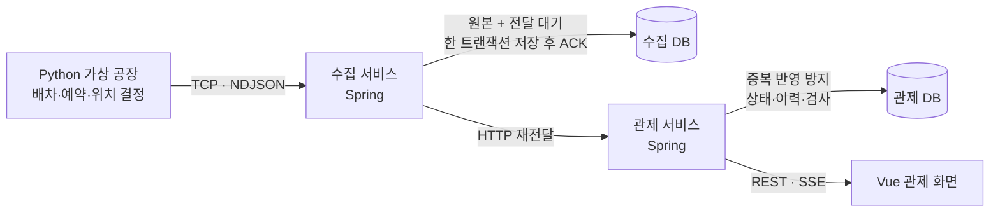

# 가상 제조공장 실시간 통합 관제 시스템

작업 셀 3개 사이를 AGV가 차체를, AMR이 부품을 운반하는 가상 공장을 만들고, 그 보고를 수집해 관제하는 SW입니다. SSAFY 관통 프로젝트 주제(자동차 제조)에서 착안한 개인 프로젝트입니다.

| 항목 | 내용 |
|---|---|
| 기간 | 2026.09 ~ 2026.10 (약 3주), 개인 프로젝트 |
| 기술 | Java 21 · Spring Boot · JDBC · PostgreSQL · Flyway │ Python 3.12 │ Vue 3 · ECharts │ TCP(NDJSON) · REST · SSE │ Docker Compose |
| 개발 방식 | 요구사항·공정 규칙 정의, 구조 설계 판단, 장애·정합성 검증은 직접 수행 / 코드 구현은 Claude Code와 함께 진행 ([개발 방식과 역할](#개발-방식과-역할)) |
| 범위 | 실제 설비 대신 Python으로 만든 가상 공장을 데이터 입력원으로 사용 (산업 프로토콜·실설비 미연동) |


*ASM-02의 대기 공간이 만석(W3 / R0 / A0)이라 ASM-01이 작업을 마치고도 차체를 내보내지 못하는 장면입니다.*

## 구조



- 배차·예약·위치 같은 물리 상태는 Python 공장 모델만 바꿉니다. 수집·관제 서버와 화면은 받은 보고를 검증·저장·표시만 합니다.
- 두 DB는 같은 PostgreSQL 안에서 서비스별 계정과 Flyway 마이그레이션으로 나눴습니다. 이중화 구조는 아닙니다.

## 공장 모델과 공정 규칙

- **구성:** 조립 셀 2개(ASM-01, ASM-02) + 검사 셀 1개(QC-01), 차체 AGV 2대, 부품 AMR 1대
- **공정:** `BODY-IN → ASM-01 → ASM-02 → QC-01 → GOOD / HOLD`, 모든 구간을 AGV가 운반
- **대기 공간(Bay):** 셀마다 차체가 들어가기 전 대기하는 공간 (기본 3면)

**핵심 규칙: 대기 + 예약으로 만석을 판단합니다.**

```text
W = 대기 공간에 실제로 있는 차체 수
R = 그 대기 공간으로 가기로 예약된 운송 수 (픽업 전·이동 중 포함)
C = 전체 슬롯 수

W + R ≥ C  →  새 배출·배차 금지
```

눈에 보이는 빈자리만 세면, 이동 중인 여러 AGV가 같은 자리를 기대할 수 있습니다. 그래서 출발 전에 목적지 슬롯을 먼저 예약하고, 도착하면 예약을 대기로 바꾸고(R→W), 셀에 들어가면 슬롯을 반환합니다. 이미 예약한 차량의 도착은 막지 않습니다.


*대기 2 · 예약 1 · 여유 0/3. 빈 슬롯이 하나 보여도 예약 때문에 새 배출이 막힙니다.*

- **가상 스마트태그:** 차체마다 태그 ID를 연결해 위치·공정·검사·운송 이력을 조회합니다. 실제 무선 장치는 재현하지 않습니다.

자세한 규칙은 [요구사항과 공정 규칙](<docs/요구사항과 공정 규칙.md>)에 있습니다.

## 설계 판단

| 판단 | 내용과 이유 | 근거 코드 |
|---|---|---|
| 물리 상태는 Python 모델만 바꾼다 | 서버나 화면이 빈 슬롯을 보고 따로 배차하면 같은 자리를 두 번 쓸 수 있다. 통신이 끊겨도 예약을 자동으로 풀지 않는다 | [ADR-001](<docs/decisions/ADR-001-서비스 책임과 데이터 소유권.md>) |
| 커밋이 끝난 뒤에만 ACK를 보낸다 | 원본과 전달 대기 정보를 한 트랜잭션에 저장해, ACK를 받은 보고는 관제 서버가 멈춰도 사라지지 않는다. 같은 보고가 다시 오면 원문을 비교해 중복과 충돌을 구분한다 | `EventStore.java` |
| 실적 중복 방지를 DB 제약과 반영 전 대조로 보장한다 | 처리한 사건·검사 결과에 PK/UNIQUE 제약을 두고, 작업·운송 보고는 이미 기록된 사실인지 먼저 대조한다. 같은 보고가 다시 와도 실적은 한 번만 집계된다 | `V1__operations_storage.sql`, `EventApplication.java` |
| 잘못된 보고와 일시적인 전달 문제를 구분한다 | 규칙에 어긋나는 보고는 고쳐서 받지 않고, 반영을 롤백한 뒤 거절 기록을 남기고 해당 실행을 멈춘다(BLOCKED, 재개 불가). 재시도 한도 초과·선행 보고 대기 같은 일시 보류(PAUSED)만 운영자가 사유를 남기고 재개한다 | `EventApplication.java`, `DeliveryStore.java` |
| 입력이 몰리면 버퍼를 무한히 늘리지 않는다 | 동시 연결 8개를 넘으면 연결을 닫고, 입력 큐(128건)·전달 대기(5,000건) 상한을 넘으면 "나중에 다시 보내라"(RETRY_LATER)로 응답한다 | `TcpReceiver.java`, `EventStore.java` |

## 관제 화면

- 공장 지도에서 셀·대기 공간·차량 상태를 한눈에 확인
- 배출이 막힌 이유를 **목적지 슬롯 만석 / 빈 AGV 대기 / 픽업 차량 대기**로 구분
- 알람은 **설비 정지 / 보고 지연 / 소스 연결 끊김** 등으로 따로 표시. 확인 버튼은 확인 기록만 남기고 설비 복구를 대신하지 않음
- 보고가 3초 넘게 늦으면 지연(STALE), 10초 넘게 없거나 연결이 끊기면 단절(DISCONNECTED), 서버 재시작 직후 새 보고 전이면 복원 중(RESTORING)으로 구분하고, 마지막 확인값과 공장 보고 시각(경과 시간)을 함께 표시
- REST와 SSE가 같은 기준(epoch·revision)의 전체 상태 묶음을 공유하고, 브라우저는 첫 SSE 묶음으로 연결 기준을 정해 지도와 상세 화면이 어긋나지 않게 함


## 검증

| 시나리오 | 결과 | 근거 |
|---|---|---|
| 차체 100대 정상 순환 (원본 3,533건) | 작업 300 · 검사 100 · 운송 400건, PASS 80 / FAIL 20이 모델·두 DB·관제 API에서 일치 | [S08 장애·복구 통합 검증](<docs/development/S08 장애·복구 통합 검증.md>) |
| 검사·운송 보고를 10번씩 다시 전송 | 실적 증가 0 | 〃 |
| ACK 유실, 수집·관제 서비스와 DB 재시작 | 재시작 후 미전달 보고 재전달, 중복 반영 없음 | 〃 |
| 정상·부하 입력 12회 측정 | 대기 중인 전달을 모두 처리한 뒤 원본 151,073건이 두 DB에서 순번·바이트·SHA-256까지 일치 | [S09 측정·완료 기록](<docs/development/S09 측정·완료 기록.md>) |

**측정 결과와 한계**
- 정상 입력(약 25건/s)에서 화면 반영 p95는 약 98ms였습니다.
- 높은 입력 목표(300·500건/s)는 송신기가 보고마다 ACK를 기다리는 구조라 목표량 자체를 만들지 못했습니다. 실제 입력은 약 97~128건/s였습니다.
- 이 구간에서 관제 전달이 수집보다 뒤처졌습니다. 1초마다 관측한 전달 대기는 최고 4,847건, 구간별 화면 반영(SSE) p95는 최대 약 54초였습니다. 대기분을 모두 처리한 뒤 유실은 없었습니다.
- 원인은 두 가지로 봅니다. 송신기가 한 번에 한 건씩 ACK를 기다리고, 전달 워커 하나가 건마다 DB 예약 → HTTP 호출 → 완료 기록을 차례로 처리합니다. 높은 처리량을 감당한다고는 보지 않으며, 순서를 지키는 묶음 전달이 다음 개선 대상입니다.

## 실행 방법

필요한 도구: Git, Docker(Compose v2 이상), Python 3.12

```sh
git clone https://github.com/kosyunderbar/smartfactorysimul.git
cd smartfactorysimul
sh scripts/dev-stack.sh env      # 처음 한 번, 로컬 환경 파일 생성
sh scripts/dev-stack.sh up       # DB·수집·관제·화면 실행
sh scripts/simulator.sh setup    # 처음 한 번, 시뮬레이터 실행 환경 준비

# 5대 시연: 예약 만석, 셀 정지·복구, 부품 AMR, PASS/FAIL
INGESTION_TCP_HOST=127.0.0.1 INGESTION_TCP_PORT=9090 \
  sh scripts/simulator.sh run --connected-p0-demo
```

관제 화면(http://127.0.0.1:5173)에서 **시뮬레이션 기록** 목록을 새로고침해 방금 실행을 고르거나, **실행 ID로 직접 연결**을 펼쳐 터미널에 출력된 `runId`를 넣고 **관측 연결**을 누릅니다. 1대만 빠르게 확인하려면 `--connected-demo`를 씁니다.

Python 3.12가 없으면 Docker 안에서 실행할 수 있습니다.

```sh
sh scripts/dev-stack.sh compose run --rm factory-simulator \
  python -m factory_simulator --connected-p0-demo
```

OS별 준비, 종료·재실행, 개발 방법은 [실행·개발 안내](<가상 제조공장 실시간 통합 관제 시스템 - 다른 컴퓨터 실행·개발 안내.md>)에 있습니다.

## 저장소 구성

```text
services/
├── factory-simulator/   Python 가상 공장
├── ingestion-service/   Spring 수집 서비스
├── operations-service/  Spring 관제 서비스
└── factory-console/     Vue 관제 화면
contracts/v1/            사건·전달·화면 규격
docs/                    요구사항, 설계 결정, 작업 기록, 검증·측정 기록
```

## 개발 방식과 역할

- **직접 한 일:** 가상 공장의 범위와 공정 규칙(대기+예약 만석, 예약 흐름, 상태 변경 주체) 정의, 서비스 경계와 데이터 전달 방식 결정, 장애 시나리오(ACK 유실, 서비스·DB 재시작, 중복 전송) 설계와 결과 대조
- **Claude Code와 함께 한 일:** 단계별 코드 구현과 문서 초안 작성
- **검증 방식:** 단계마다 로컬에서 실제로 실행해 확인한 뒤 정리해 올렸고, 진행 과정과 결과는 [작업 기록 42건](docs/work-notes/)에 남겼습니다.

## 문서 안내

| 문서 | 내용 |
|---|---|
| [요구사항과 공정 규칙](<docs/요구사항과 공정 규칙.md>) | 해결하려는 문제, 공장 모델, 만석·예약 규칙 |
| [ADR-001 서비스 책임과 데이터 소유권](<docs/decisions/ADR-001-서비스 책임과 데이터 소유권.md>) · [ADR-002 측정 근거와 완료 범위](<docs/decisions/ADR-002-측정 근거와 P0 완료 범위.md>) | 설계 결정 기록 |
| [사건 규격](contracts/v1/events.md) · [전달 규격](contracts/v1/delivery.md) · [화면 규격](contracts/v1/monitoring.md) | 서비스 사이에 주고받는 데이터 형식 |
| [S08 장애·복구 통합 검증](<docs/development/S08 장애·복구 통합 검증.md>) · [S09 측정·완료 기록](<docs/development/S09 측정·완료 기록.md>) | 검증·측정 결과 |
| [작업 기록](docs/work-notes/) | 단계별 작업 내용 42건 |
| [단계별 실행·검증 명령](<docs/development/단계별 실행·검증 명령.md>) | 개발 단계별 확인 명령 |
